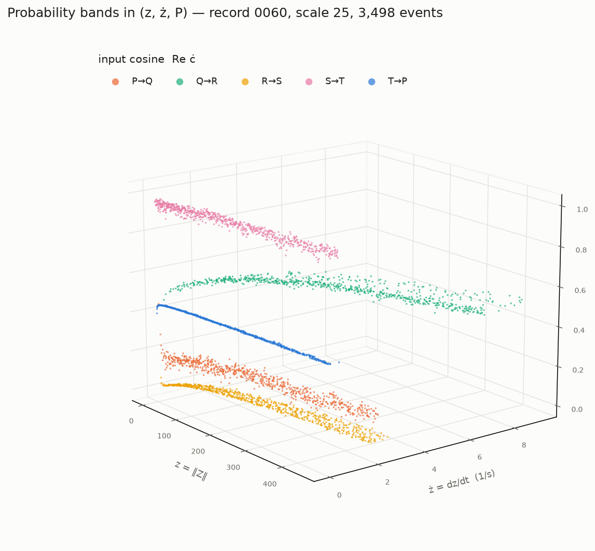
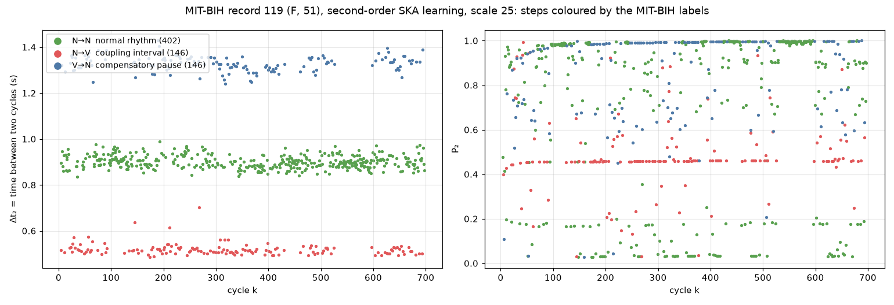
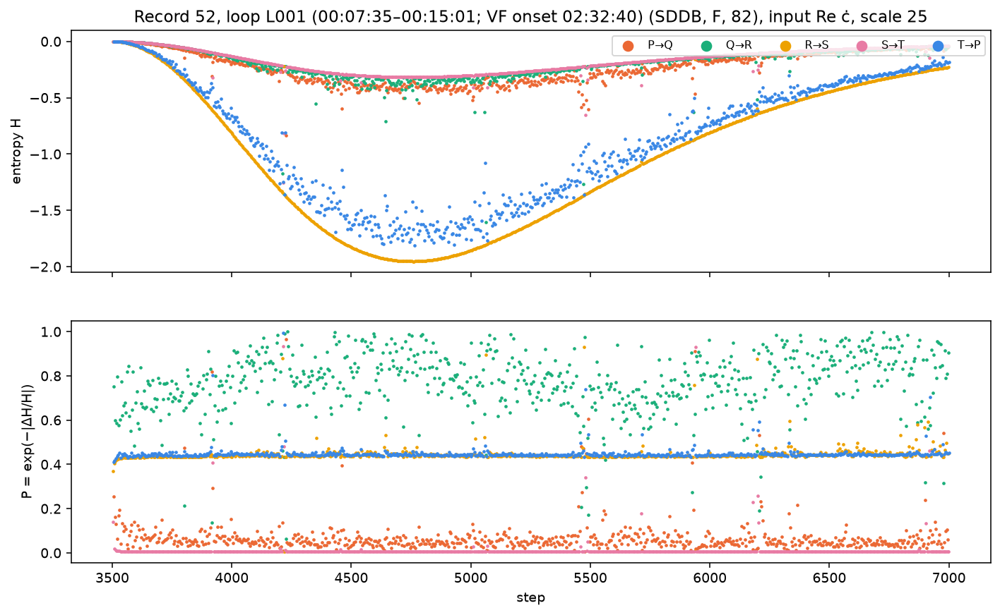
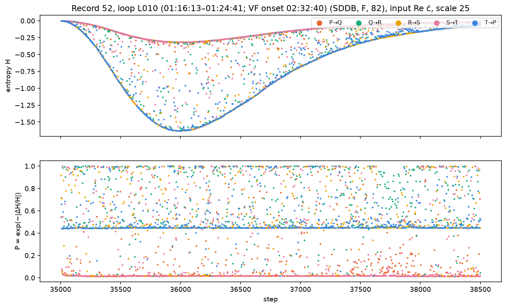

# Abstract

The electrocardiogram is usually reduced to positions, intervals and the R--R series before any
analysis. This proposal follows a different path: the raw ECG is read as an ordered stream of
waves, P $\to$ Q $\to$ R $\to$ S $\to$ T, and each wave is one step of the Structured Knowledge
Accumulation (SKA) real-time learner [1, 2]. The learner is not trained on labels. It reduces its
own entropy only where the stream carries structure, and the five transitions of the cardiac
cycle form their own bands in the learner's space.

Across public PhysioNet databases, the learner registers the five transitions of healthy hearts,
the time it needs to saturate its entropy ($\tau_H$, $N_H$), and, on a long Holter recording ending
in ventricular fibrillation, loops where the structure of the cycle is lost. We propose the
**entropy cube** $(z, \dot z, H)$ as the standard object of a heart, recorded under fixed
conditions, and a monitoring set-up that learns one loop per hour or per day, so that the
structure of a heart can be followed over time.

All results cited here are public, with their cubes, in the repositories listed in Section 9.

# 1. Background

**SKA.** Structured Knowledge Accumulation is a forward-only learning framework in which learning
is the reduction of an entropy, defined on the learner's knowledge $z$ and its decision
probabilities [1]. Learning follows a principle of entropic least action, and the time to complete
it defines a characteristic time [2]. The real-time learner used here reads one value per step,
in order, and its entropy $H$ is recorded at every step.

**Why the raw waveform.** Classical heart rate variability reduces the ECG to the R--R intervals.
Here the learner reads the full cycle: every wave is a step, and the rhythm appears in the time
between steps rather than being extracted beforehand.

**Following Wheeler.** *"No elementary phenomenon is a phenomenon until it is a registered
(observed) phenomenon"* [10]. The transition bands are not values present in the ECG: they are
registered by the interaction between the ordered stream of waves and the learner. They are not in
a histogram of the input, which discards the order of the waves, and they form only as the
learner's entropy falls.

# 2. Method

**Wave detection.** For each cycle, the peaks of P, Q, R, S, T are located on the raw signal. R is
found with a Pan--Tompkins-type detector [6] (50 Hz notch, 5--20 Hz band, squared slope, 150 ms
energy window); P, Q, S and T are found in windows around R. The detection was checked against the
cardiologists' annotations of the LUDB database [9], 200 records, lead II (Table 1, Figure 1).

| wave | annotated | matched | median error | within 20 ms | inside the annotated wave | false detections |
|---|---|---|---|---|---|---|
| P | 1,401 | 96.5 % | 2 ms | 97.2 % | 99.0 % | 3 / 1,355 |
| R | 1,817 | 95.0 %$^{a}$ | 2 ms | 99.0 % | --- | 5 / 1,729 |
| T | 1,642 | 90.1 % | 4 ms | 90.7 % | 94.2 % | 86 / 1,565 |
| Q | 1,726 QRS | --- | --- | --- | 82.1 % | --- |
| S | 1,726 QRS | --- | --- | --- | 81.1 % | --- |

: Detection against the LUDB annotations. False detections are counted in records where the wave
is annotated. In 23 records with atrial fibrillation or flutter no P is annotated, and the detector
still reports a P in each cycle.
$^{a}$ The detector returns a cycle only between two R peaks, so the first and last QRS of each
10-s record are not returned. Of the 91 unmatched QRS, 54 lie before the first or after the last
returned cycle, 21 are in two records (83, 105) where only two R peaks are found, and 16 are elsewhere.

{width=100%}

**Complex events.** One cycle is read as one turn of a circle whose circumference is the cycle
period, $T = 2\pi r$. Each wave $j$ is summed over its arc into a phasor

$$
c_j = \frac{1}{r} \sum_{t \in \mathrm{arc}_j} x(t)\, e^{\,i t / r},
$$

and the learner's input is the change of the phasor from one wave to the next,
$\dot c_n = c_n - c_{n-1}$, taken as $\mathrm{Re}\, \dot c_n$. A wave that does not reach its
expected sign is marked absent.

**Learning.** One step per wave, five steps per cycle. A run is 700 cycles (3,500 waves). The time
between steps, $\Delta t$, is the real time between successive wave peaks. At each step the learner
gives its knowledge $z = \lVert Z \rVert$, its rate $\dot z = dz/dt$ and its entropy $H$.

# 3. The entropy cube as the standard object of a heart

Each transition P$\to$Q, Q$\to$R, R$\to$S, S$\to$T, T$\to$P forms its own band in the learner's
space (Figure 2). Three vertical axes have been used: the transition probability $P$, the time
$\Delta t$ and the entropy $H$. We propose the entropy cube $(z, \dot z, H)$ as the standard object:
it measures how the heart is structured, and the bands of the five transitions separate there.

{width=70%}

For cubes to be compared between hearts and over time, they must be recorded under the same
conditions:

| condition | standard |
|---|---|
| sampling frequency | 1000 Hz |
| lead | II |
| input | $\mathrm{Re}\, \dot c$ |
| scale | 25 |
| run length | long enough for the entropy to saturate |

: The standard conditions of an entropy cube.

The learner learns only when it finds structure. A richer structure needs more cycles before the
entropy saturates, so the run length is set by saturation, not by a fixed duration.

**Entropic characteristic time.** $\tau_H$ is the time, $\sum_k \Delta t_k$, at which the entropy of the
slowest of the five transitions is 90 % saturated. $N_H = \tau_H / T_c$, with $T_c$ the mean cycle
time of the run, removes the heart rate and counts cycles.

# 4. What is registered so far

**Healthy women, 18 to 92 (Autonomic Aging [3], 1000 Hz).** 38 women, one 700-cycle run
each: 30 women, two per age band, at a scale chosen per woman before the standard above was set,
and 8 more women aged 18--19 at scale 25. The five transitions form five bands in each of the 30.
Over the 38, $\tau_H$ ranges from 6.7 to 13.4 min, and $N_H$ from 515 to 695 cycles.

**Healthy subjects at 250 Hz (Fantasia [4], Sport DB 2.0 [5]).** 39 young and elderly subjects at
supine rest, and 23 athletes at rest, learned with the same method. These recordings are at
250 Hz and are therefore outside the standard.

**Myocardial infarction (PTB [7], 1000 Hz).** Healthy controls and patients with myocardial
infarction, from the day of the infarction to several months later, with the missing waves of
each cycle tagged in the cubes. The PTB records last about two minutes: they are not sufficient
for entropy saturation, and no $\tau_H$ is defined for them.

**Arrhythmia: what the bands correspond to (MIT-BIH [11], 360 Hz).** In the second order, the
learner reads its own first-order result, one step per cycle: each step is the passage from one
cycle to the next, and it carries the cardiologists' labels of both cycles. Record 119 (woman, 51)
alternates normal cycles (N) and premature ventricular contractions (V), in bigeminy (N V N V) and
trigeminy (N N V). Its steps form three bands that follow the labels exactly (Figure 3): N$\to$V,
the coupling interval (0.49--0.70 s, 146 steps); N$\to$N, the normal rhythm (0.84--0.99 s, 402);
V$\to$N, the compensatory pause (1.24--1.43 s, 146). This vertical axis, $\Delta t_2$, is the time
between two cycles. In the learner's own probability $P_2$, the coupling interval N$\to$V forms its
own band, at $P_2 \approx 0.46$, apart from the normal steps.

{width=100%}

**Hours before and after ventricular fibrillation (SDDB [8], 250 Hz).** Record 52 (woman, 82,
sinus rhythm, VF onset 02:32:40), 7 h 31 min, learned as 60 successive loops of 700 cycles, each by
a fresh learner at scale 25.

| loops | time in the recording | $N_H$ (cycles) |
|---|---|---|
| L000--L002 | 00:00--00:22 | 673--689 |
| L003--L017 | 00:22--02:18 | 413--603 |
| L018 | 02:18--02:25 | 624 |
| L019 (VF onset) | 02:25--02:33 | 416 |
| L020--L023 | 02:33--02:59 | 396--513 |
| L024--L059 | 02:59--07:30 | 391--694 |

: $N_H$ of the successive loops of SDDB record 52.

In the first loops the five transitions keep separate entropy curves and separate levels of $P$
(Figure 4). From loop L003, for about two hours before the fibrillation, the steps scatter between
the curves and the levels mix (Figure 5): the learner saturates in fewer cycles because it finds
less structure. $N_H$ recovers in L018 (624) before falling again in L019, the loop of the VF
onset. After the event, $N_H$ varies from loop to loop over the whole range.

{width=95%}

{width=95%}

# 5. Hypothesis

A pathology does not come suddenly. If the structure of the heart is lost before an event, the
loss should be visible in the entropy cube, loop after loop, before the event.

This is a hypothesis. Record 52 is a single recording of a single patient, and it is at 250 Hz.

# 6. Proposed work

1. **SDDB records 30, 45 and 51**, which have long recordings before the VF onset, learned in
   successive loops as record 52.
2. **Standard recordings.** 1000 Hz, lead II, runs long enough for saturation, to build a library
   of entropy cubes of healthy hearts and of hearts with a known condition.
3. **Monitoring.** A small lead II capture device with three electrodes, and a mobile phone hosting
   the database and the dashboards. The phone sends the events of each loop ($\mathrm{Re}\, \dot c$,
   $\Delta t$), not the raw ECG, to a remote SKA engine API, and receives the loop's cube. One loop
   per hour or per day, so that each heart is compared with itself over time.
4. **Other physiological signals.** The ECG is one parameter of the heart. Blood pressure, recorded
   continuously with the ECG in the Autonomic Aging database, can be read the same way.

# 7. What SKA does not do

SKA is not a classifier and gives no diagnosis. It does not produce a risk score and is not trained
on labels. It registers the structure of the stream it reads; what that structure means for a
patient is for cardiologists to establish.

# 8. Collaboration

We seek cardiologists and research groups with access to long ECG recordings, ideally at 1000 Hz,
or to patients followed over time, to read the cubes with us and to establish what the loss of
structure corresponds to.

# 9. Repositories

All results, figures and cubes are public. The cubes open in a browser or in a VR headset. The SKA
real-time engine is proprietary and is not included.

- SKA-ECG-Heart-Rate-Variability: <https://github.com/quantiota/SKA-ECG-Heart-Rate-Variability>
- SKA-ECG-Pathology: <https://github.com/quantiota/SKA-ECG-Pathology>
- SKA-ECG-SDDB: <https://github.com/quantiota/SKA-ECG-SDDB>
- SKA-ECG-Fantasia: <https://github.com/quantiota/SKA-ECG-Fantasia>
- SKA-ECG-Athletes: <https://github.com/quantiota/SKA-ECG-Athletes>
- SKA-ECG-Detection-Validation: <https://github.com/quantiota/SKA-ECG-Detection-Validation>
- SKA-ECG-Arrhythmia: <https://github.com/quantiota/SKA-ECG-Arrhythmia>
- SKA-ECG-Arrhythmia-Second-Order (record 119): <https://github.com/quantiota/SKA-ECG-Arrhythmia-Second-Order>
- SKA-ECG-Second-Order, SKA-ECG-Third-Order: <https://github.com/quantiota>

# References

1. B. Mahi. Structured Knowledge Accumulation: An Autonomous Framework for Layer-Wise Entropy
   Reduction in Neural Learning. arXiv:2503.13942, 2025.
2. B. Mahi. Structured Knowledge Accumulation: The Principle of Entropic Least Action in
   Forward-Only Neural Learning. arXiv:2504.03214, 2025.
3. A. Schumann, K. Bär. Autonomic Aging: A dataset to quantify changes of cardiovascular autonomic
   function during healthy aging (version 1.0.0). PhysioNet, 2021. doi:10.13026/2hsy-t491.
4. N. Iyengar et al. Age-related alterations in the fractal scaling of cardiac interbeat interval
   dynamics. Am J Physiol 271:R1078--R1084, 1996. doi:10.1152/ajpregu.1996.271.4.R1078.
5. Romagnoli et al. Computing in Cardiology, 2023. doi:10.22489/CinC.2023.067. Data: Sport DB 2.0, Mendeley Data.
6. J. Pan, W. J. Tompkins. A real-time QRS detection algorithm. IEEE Trans Biomed Eng
   32(3):230--236, 1985.
7. R. Bousseljot, D. Kreiseler, A. Schnabel. Nutzung der EKG-Signaldatenbank CARDIODAT der PTB
   über das Internet. Biomedizinische Technik 40 (Erg. 1):S317, 1995. PhysioNet doi:10.13026/C28C71.
8. S. D. Greenwald. Development and analysis of a ventricular fibrillation detector. M.S. thesis,
   MIT, 1986. PhysioNet doi:10.13026/C2W306.
9. A. I. Kalyakulina et al. LUDB: A New Open-Access Validation Tool for Electrocardiogram
   Delineation Algorithms. IEEE Access 8:186181--186190, 2020. doi:10.1109/ACCESS.2020.3029211.
10. J. A. Wheeler. Information, Physics, Quantum: the Search for Links. Proc. 3rd Int. Symp.
    Foundations of Quantum Mechanics, Tokyo, 1989, pp. 354--368.
11. G. B. Moody, R. G. Mark. The impact of the MIT-BIH Arrhythmia Database. IEEE Eng Med Biol
    20(3):45--50, 2001. PhysioNet doi:10.13026/C2F305.
